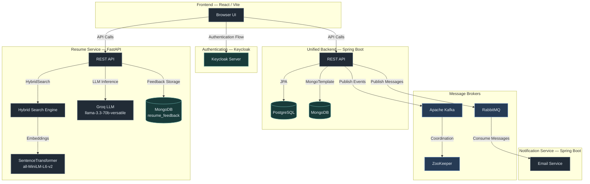
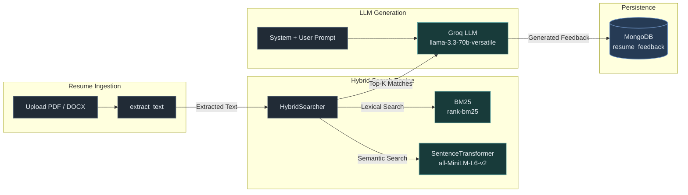

# Placement Syndicate Mini

A **modular, client‑server system** that helps students gauge interview experiences and get AI‑driven, data‑grounded feedback on their resumes.

---

## 1. Project Overview

Placement Syndicate Mini combines three independent back‑end services, a React front‑end, and a lightweight AI pipeline:

| Service | Language / Framework | Primary Responsibility |
|---|---|---|
| **unified‑backend** | Java 17, Spring Boot | Core REST API for user management, experience catalog, mentorship programs, and health checks. |
| **resume‑service** | Python 3.12, FastAPI | PDF/DOCX resume ingestion, hybrid lexical‑semantic search, LLM‑based gap analysis. |
| **notification‑service** | Java 17, Spring Boot | Email notifications (OTP, enrollment, new experience alerts). |
| **frontend** | React 19 (Vite) | UI for students/mentors; authenticates via Keycloak and calls the back‑ends. |

All services are containerised and orchestrated through **docker‑compose**.

---

## 2. Problem Statement

Students often lack concrete data on the interview process for target companies.  The platform aggregates interview experiences, enables similarity search, and generates actionable feedback tied to real candidate stories rather than generic career advice.

---

## 3. Key Features

* **Experience Catalog** – CRUD for interview experiences (company, role, questions, tips). Stored in MongoDB.
* **Mentorship Programs** – Create & enroll in programs; enrollment triggers email notifications.
* **AI‑Powered Resume Review** – Upload PDF/DOCX → hybrid search → Groq LLM generates a gap‑analysis report grounded in the matched experiences.
* **Keycloak‑based SSO** – Centralised authentication for the UI and back‑ends.
* **Event‑driven Architecture** – Kafka for async program‑related events, RabbitMQ for other internal notifications.
* **Health & Monitoring** – `/actuator/health` endpoint and OpenAPI UI (Springdoc).

---

## 4. Technology Stack

| Layer | Technology |
|---|---|
| **API** | Spring Boot (Java), FastAPI (Python) |
| **Front‑end** | React 19, Vite, keycloak‑js, axios |
| **AI/ML** | Sentence‑Transformers **all‑MiniLM‑L6‑v2**, BM25 (rank‑bm25), Groq LLM (llama‑3.3‑70b‑versatile) |
| **Databases** | PostgreSQL (user data), MongoDB (experience & resume feedback) |
| **Message Brokers** | Kafka, RabbitMQ, Zookeeper |
| **Auth** | Keycloak (OpenID Connect) |
| **Containerisation** | Docker, docker‑compose |
| **Build / CI** | Maven (Java services), pip (Python), npm (frontend) |

---

## 5. System Architecture




**Key points**
* The system follows a *modular monolith* pattern – each back‑end service is independent but shares the same Docker network.
* Communication between UI and services is purely HTTP/HTTPS; internal events use Kafka/RabbitMQ.
* Authentication is delegated to Keycloak; JWT tokens are validated by Spring Security in the unified‑backend and by the FastAPI CORS‑allow‑any policy for demo purposes.

---

## 6. Architecture Components

### 6.1 Unified Backend (Java)
* **Entry point** – `UnifiedBackendApplication.java` (Spring Boot starter).
* **Controllers** – `UserController`, `AuthController`, `ExperienceController`, `MentorshipController`, `UnifiedHealthController`.
* **Services** – Business logic (e.g., `UserService`, `ExperienceService`).
* **Repositories** – Spring Data JPA for PostgreSQL (`UserRepository`) and Spring Data MongoDB for Mongo (`ExperienceRepository`).
* **Security** – `UnifiedSecurityConfig` configures resource‑server JWT validation against Keycloak.
* **OpenAPI** – `springdoc-openapi-starter-webmvc-ui` provides Swagger UI at `/swagger-ui.html`.

### 6.2 Resume Service (Python)
* **Entry point** – `main.py` runs FastAPI on port 8050.
* **Routes** – `/api/resume/upload`, `/api/resume/feedback/{filename}`, `/api/resume/similar/{company_name}`.
* **HybridSearcher** – combines BM25 (`rank_bm25`) and semantic embeddings (`sentence_transformers`). Lazy‑loads the transformer model (`all-MiniLM-L6-v2`).
* **LLMClient** – wraps the Groq SDK; prompts are strictly grounded in DB matches (see `llm_client.py`).
* **Persistence** – MongoDB collections `experience`, `resume_feedback`.

### 6.3 Notification Service (Java)
* Sends OTP and enrollment e‑mails via Spring `JavaMailSender`.
* Exposes `NotificationController` with endpoints like `/api/notify/otp` (called from the Auth service).

### 6.4 Front‑end (React)
* **AuthContext** – wraps `keycloak-js` to provide JWT and user info.
* **Routing** – `react-router-dom` defines protected routes (`ProtectedRoute.jsx`).
* **API layer** – `services/api.js` (axios instance with interceptor to inject the JWT). Separate modules for resume (`resumeApi.js`).
* **Pages** – Home, Login, Signup, Profile, Experience list, Mentor dashboard, Resume upload, etc.

---


## 7. AI/ML Model & Inference Pipeline




* **Hybrid Search** – BM25 provides lexical relevance; Sentence‑Transformer embeddings capture semantic similarity. Scores are combined (`0.2 * BM25 + 0.8 * semantic`).
* **LLM** – Groq endpoint `chat.completions.create` with deterministic temperature 0.2. The system prompt enforces *ground‑truth only* policy; the user prompt contains the raw resume excerpt and JSON‑encoded match context.
* **No fine‑tuning** – The model is used **as‑is** via the Groq API; all personalization is performed in the prompt.
* **Limitations** – Accuracy depends on the size & coverage of the MongoDB experience collection; the LLM is a black‑box service (no local inference).

---

## 8. End‑to‑End Application Workflows

### 8.1 Resume Feedback Workflow
1. **User** uploads a PDF/DOCX in the UI (`ResumeUploadPage`).
2. **Frontend** sends `POST /api/resume/upload` to the FastAPI service.
3. **FastAPI** extracts raw text (`extract_text`).
4. It loads the **experience** collection from MongoDB.
5. **HybridSearcher** is `fit` with all experiences and performs a hybrid search against the resume text.
6. Top‑k matches are passed to **LLMClient** which builds a system + user prompt and calls **Groq**.
7. The LLM returns a grounded gap‑analysis report.
8. The service stores the report and metadata in `resume_feedback`.
9. **Frontend** polls `GET /api/resume/feedback/{filename}` to display the advice.

### 8.2 User Registration & Authentication
1. **User** signs up via the UI (Keycloak page).
2. **Keycloak** creates the user and issues a JWT.
3. UI stores the token and includes it in the `Authorization: Bearer …` header.
4. Protected calls (e.g., `GET /api/experience/me`) are routed to **unified‑backend**.
5. **UnifiedSecurityConfig** validates the JWT against Keycloak’s public key.
6. Controllers extract the user id (`@AuthenticationPrincipal Jwt`) and forward it to services.
7. Data is persisted in PostgreSQL (`User` table) and MongoDB (`experience` collection) as appropriate.

---

## 9. Database Design

### 9.1 PostgreSQL (`user_db`)
* **users** – `id`, `username`, `email`, `password_hash`, `roles`.
* **programs** – `id`, `name`, `description`, `company`, `deadline`.
* **enrollments** – `id`, `user_id` (FK), `program_id` (FK), `status`.

### 9.2 MongoDB (`experiencedb`)
* **experience** – documents with fields: `companyName`, `role`, `quetions` (note the misspelling), `tips`, `difficultyLevel`, `round` etc.
* **resume_feedback** – `filename`, `advice`, `matches` (company + score), `timestamp`, `status`.

No foreign‑key constraints exist across the two stores; the services keep the relationship logic in code.

---

## 10. API Reference (selected endpoints)

| Service | Method | Path | Summary |
|---|---|---|---|
| **Unified Backend** | `POST` | `/api/auth/signup` | Register a new user. |
|  | `POST` | `/api/auth/login` | Authenticate and receive JWT. |
|  | `GET` | `/api/experience/me` | List experiences owned by the authenticated user. |
|  | `POST` | `/api/experience/register` | Add a new interview experience (admin‑only). |
|  | `GET` | `/api/mentorship/programs` | Retrieve available mentorship programs. |
|  | `POST` | `/api/mentorship/enroll` | Enroll in a program (triggers email). |
| **Resume Service** | `POST` | `/api/resume/upload` | Upload resume, run hybrid search + LLM, store feedback. |
|  | `GET` | `/api/resume/feedback/{filename}` | Retrieve latest feedback report for a file. |
|  | `GET` | `/api/resume/similar/{company_name}` | Get companies with similar interview patterns. |
| **Notification Service** | `POST` | `/api/notification/otp` | Send OTP email (used by auth flow). |

All secured endpoints require a Bearer JWT issued by Keycloak.

---

## 11. Project Structure (high‑level)

```
Placement-Syndicate-mini/
├─ docker-compose.yml               # orchestration of all containers
├─ unified-backend/                 # Spring Boot monolith
│   └─ src/main/java/com/mini/...   # controllers, services, models
├─ resume-service/                  # FastAPI service
│   ├─ main.py
│   ├─ hybrid_search.py
│   └─ llm_client.py
├─ notification-service/            # Spring Boot email service
├─ frontend/                        # React + Vite UI
│   ├─ src/App.jsx
│   ├─ src/pages/...                # UI pages
│   └─ src/services/api.js
├─ dummy-services/                  # placeholder service for local dev
└─ docs/                            # documentation (generated)
```

---

## 12. Installation & Local Setup

> **Prerequisites** – Docker Compose, Java 21, Maven, Python 3.12, Node 20.

```bash
# 1. Clone the repo (already done for you)
cd /Users/armank.b/Desktop/Placement-Syndicate-mini

# 2. Create a .env file (copy from example if present) – at least:
cat > .env <<EOF
GROQ_API_KEY=your_groq_api_key_here
LLM_MODEL=llama-3.3-70b-versatile
MONGO_URI=mongodb://mongodb:27017
EOF

# 3. Build and start all containers
docker compose up -d --build

# 4. Apply DB migrations (PostgreSQL) – the JPA schema auto‑creates tables.
#    MongoDB collections are created on first write.

# 5. Install front‑end dependencies and run dev server
cd frontend
npm install
npm run dev   # Vite dev server on http://localhost:5173

# 6. (Optional) Run resume‑service locally without Docker
cd ../resume-service
pip install -r requirements.txt
uvicorn main:app --reload --port 8050
```

### Environment Variables
| Variable | Description |
|---|---|
| `GROQ_API_KEY` | API key for Groq LLM service (required for resume feedback). |
| `LLM_MODEL` | Model identifier – defaults to `llama-3.3-70b-versatile`. |
| `MONGO_URI` | MongoDB connection string (used by both Java and Python services). |
| `POSTGRES_USER` / `POSTGRES_PASSWORD` / `POSTGRES_DB` | Set in `docker-compose.yml` for the user DB. |

---

## 13. Running the Application

| Service | Command (inside container) |
|---|---|
| **Unified Backend** | `java -jar target/unified-backend-0.0.1-SNAPSHOT.jar` (handled by Docker). |
| **Resume Service** | `uvicorn main:app --host 0.0.0.0 --port 8050` (Docker entrypoint). |
| **Notification Service** | Same pattern as unified‑backend (Spring Boot jar). |
| **Frontend** | `npm run dev` (Vite) – proxies `/api/*` to the appropriate back‑ends via `vite.config.js`. |

Health checks:
* Unified Backend – `GET http://localhost:8080/actuator/health`
* Resume Service – `GET http://localhost:8050/api/resume/ping`
* Notification Service – `GET http://localhost:8081/actuator/health` (if exposed).

---

## 14. Testing & Validation

* **Java tests** – `mvn test` inside `unified-backend` (JUnit, Spring Boot Test).
* **Python tests** – none provided; you can invoke the FastAPI test client manually.
* **Frontend lint** – `npm run lint`.
* **Integration** – After `docker compose up`, open the UI, sign up via Keycloak, upload a resume, and verify the feedback appears.

---

## 15. Deployment Architecture

The production deployment mirrors the Docker‑compose stack, typically on a cloud VM or a Kubernetes namespace. Services are exposed via an ingress controller; TLS termination is performed at the edge. Keycloak runs as a separate identity provider.

---

## 16. Technical Design Decisions

| Decision | Rationale |
|---|---|
| **Hybrid search (BM25 + Sentence‑Transformer)** | Balances cheap lexical matching with semantic understanding while staying within free‑tier memory limits. |
| **Groq LLM (API‑only)** | Avoids heavy GPU requirements; enables deterministic responses with low latency. |
| **Separate MongoDB for experiences** | Schemaless interview records fit naturally in a document store; fast vector search on in‑memory embeddings. |
| **Keycloak for auth** | Off‑loads token issuance and user‑management; integrates directly with Spring Security. |
| **Kafka + RabbitMQ** | Demonstrates event‑driven design; Kafka for high‑throughput program events, RabbitMQ for low‑latency email notifications. |

---

## 17. Limitations & Future Improvements

* **Search scalability** – Current hybrid search loads all documents into memory; a vector DB (e.g., Milvus) would enable larger corpora.
* **Model provenance** – LLM is a black‑box service; fine‑tuning on domain‑specific data could improve relevance.
* **Unified API gateway** – A single API gateway would simplify client routing and centralise rate limiting.
* **Testing coverage** – Add integration tests for the resume pipeline and end‑to‑end UI flows.
* **Docker‑compose secrets** – Move API keys to Docker secrets or a vault for production.

---

## 18. Diagrams

All diagrams are included inline as Mermaid; they render directly on GitHub.

---

*Prepared by Antigravity AI – a technical documentation assistant.*
